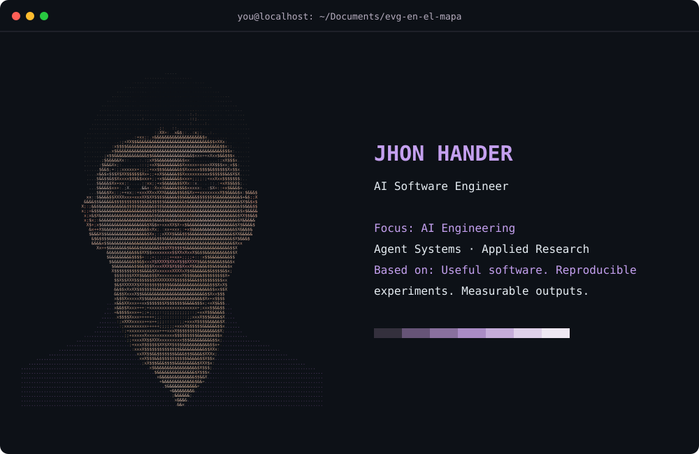

<code>you@localhost$ fastfetch</code>

<picture><source media="(max-width: 767px)" srcset="./assets/profile-mobile.svg"></picture>

<h2><code>$ cat about.md</code></h2>

AI Software Engineer with a background in software engineering at IUE. I build AI-powered software, from retrieval pipelines and multi-agent workflows to language model fine-tuning and full-stack applications. My work connects software engineering with applied AI research, focusing on useful tools, reproducible experiments, and systems that can be inspected and evaluated.

<h2><code>$ cat experience.log</code></h2>
<ul>
<li><strong>Bancolombia</strong> — Software Engineer, Model Risk Management (MRM)</li>
<li><strong>Genios Tecnológicos</strong> — AI Engineer</li>
<li><strong>MinCiencias</strong> — Researcher</li>
</ul>

<h2><code>$ cat now.txt</code></h2>
<ul>
<li><strong>Research</strong> — Spanish clinical QA, language model fine-tuning, and evaluation</li>
<li><strong>Building</strong> — Research tools, MCP integrations, and reusable agent skills</li>
<li><strong>Focus</strong> — Multi-agent orchestration, RAG, and automation</li>
<li><strong>Ask me about</strong> — GenAI, Agent Systems, and Full Stack Development</li>
<li><strong>Fun fact</strong> — The more I learn, the less I know, but the more excited I get about possibilities</li>
</ul>

<h2><code>$ ls skills/</code></h2>

<strong><code>software-development/</code></strong> <strong>Languages:</strong> Python · JavaScript · TypeScript · Java <strong>Frameworks &amp; data:</strong> React · Angular · Node.js · NestJS · Express · Spring Boot · FastAPI · SQL · MySQL

<strong><code>ai-engineering-and-agents/</code></strong> <strong>Agents &amp; retrieval:</strong> LangGraph · LangChain · RAG · Vector Search · MCP <strong>Evaluation &amp; ML:</strong> Langfuse · TensorFlow

<strong><code>infrastructure-and-automation/</code></strong> Git · Docker · AWS · n8n

<h2><code>$ gh stats</code></h2>

<a href="https://github.com/JhonHander?tab=overview">contributions ↗</a> · <a href="https://github.com/JhonHander?tab=repositories">repositories &amp; languages ↗</a>

<code>you@localhost$</code>

